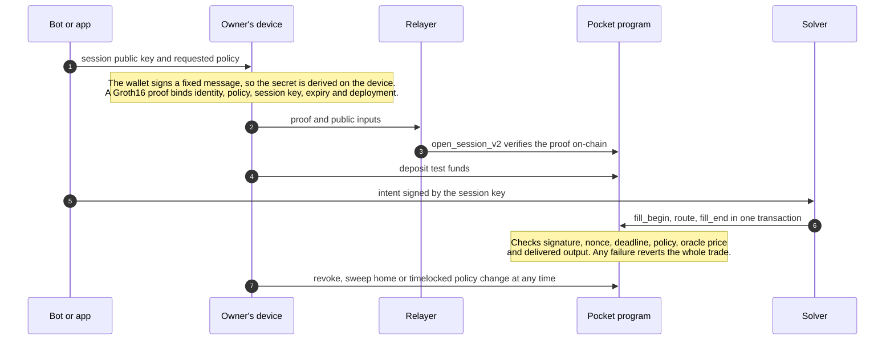

<h1 align="center">GhostLink</h1>

<p align="center"><strong>Prove what an app needs. Give it only the spending authority you approve.</strong></p>

<p align="center">Zero-knowledge login and policy-bounded spending accounts for Solana apps and trading bots.<br>No wallet address in the login proof. No private key handed to the bot.</p>

<p align="center">
  <a href="https://github.com/Ghostlink-Labs/ghostlink/actions/workflows/ci.yml"></a>
  <a href="LICENSE"></a>
  
  
  
</p>

<p align="center">
  <a href="#quickstart">Quickstart</a> ·
  <a href="#how-it-works">How it works</a> ·
  <a href="#packages">Packages</a> ·
  <a href="#documentation">Docs</a> ·
  <a href="https://app.ghostlink.software">Devnet app</a> ·
  <a href="https://ghostlink.software">Website</a> ·
  <a href="CONTRIBUTING.md">Contribute</a>
</p>

---

Trading bots ask for your private key. "Connect wallet" logins tie your on-chain history to every site you use. One leaked key or one careless approval can empty a wallet.

**GhostLink separates proving who you are from giving an app permission to spend.**

| | |
| --- | --- |
| **Private login** | Prove you are a registered user, or that you held at least N of a token, with a zero-knowledge proof. The proof does not contain your wallet address, and every site sees its own stable user ID that cannot be linked to your ID on any other site. |
| **Pockets** | Each app gets its own on-chain account with rules you approve: a daily USD cap, a slippage limit, allowed tokens and a maximum session length. Money leaves a pocket only through a trade that settles inside those rules, or back to your home wallet. |
| **Session keys** | A bot gets a temporary key that signs exact swap intents for one pocket. It cannot withdraw anywhere but your home wallet, raise its own limits or change where recovery goes. Revoke it at any time. |

Proofs are Groth16 over BN254, generated on the user's device and verified **on-chain** by the Solana programs, or by your server for off-chain login.

> [!WARNING]
> **Experimental. Not for real funds.** The code on `main` runs on a local validator out of the box. There is no official public devnet or mainnet deployment; you can [create your own](docs/DEPLOYMENTS.md) with your own program keys, and the SDK and services refuse public clusters without such a deployment manifest. The proving keys come from a single-party development setup, and the code has not had an external security audit. See [project status](#project-status).

## Quickstart

Verify a real zero-knowledge login proof in under a minute. You need Node 22.16 or newer (or Node 24) and pnpm 10; `corepack enable` installs the pinned version. On Windows, if `corepack enable` fails with `EPERM`, run it once in an administrator terminal, or install pnpm with `npm install -g pnpm@10.33.2`.

```bash
git clone https://github.com/Ghostlink-Labs/ghostlink.git
cd ghostlink
corepack enable
pnpm install --frozen-lockfile
pnpm -r build
pnpm --filter @ghostlink/example-verify-login start
```

```text
GhostLink login verification: a real Groth16 proof with no wallet address inside

ok    valid proof for this site                  accepted, app user ID 128256...5697
ok    replayed on another site                   rejected: proof bound to a different domain
ok    site demands 200 tokens, proof shows 100   rejected: threshold below requirement
ok    same proof a day later: snapshot too old   rejected: snapshot window too old
ok    built against an unknown tree              rejected: unknown registry root
ok    tampered public signal                     rejected: proof failed verification
```

Then try the [bot session example](examples/bot-session/src/index.ts) (`pnpm --filter @ghostlink/example-bot-session start`), or run **the whole system on a local validator** (Linux or WSL with the Solana toolchain, see [setup](docs/SETUP.md)). Proving needs circuit files that are too large for Git, so download the development ones, which match the committed verifying keys:

```bash
node scripts/proving-artifacts.mjs fetch   # development proving files from the v0.1.0 release, checked by SHA-256
bash scripts/build-programs.sh
bash scripts/localnet-e2e.sh               # register → snapshot → consent → prove → open → fund → trade → recover
```

To build the circuits and your own development keys instead (needs circom), see [fresh local proving setup](docs/SETUP.md#fresh-local-proving-setup).

## Use it

One program, from creating the client to a verified login, a bot with a budget and getting the funds back. Every value is built here or declared as something your app already has (`declare`), and the repository's packaging check compiles these examples against the packed packages. Run the reference services on a local validator with `GHOSTLINK_KEEP_RUNNING=1 bash scripts/localnet-e2e.sh` to try it; [`services/e2e/src/run.ts`](services/e2e/src/run.ts) makes the same calls end to end. The [SDK guide](packages/sdk/README.md) explains each step, the errors and the options.

### Connect, register, snapshot

```ts
import { GhostLink, deriveIdentity, jsonRpcChainReader } from "@ghostlink/sdk";
import { createWorkerProver } from "@ghostlink/prover-wasm";
import { LOCALNET_DEPLOYMENT, toBase58 } from "@ghostlink/common";

// From your wallet connection: the 32-byte public key and its Ed25519 signMessage.
declare const walletPublicKey: Uint8Array;
declare const signMessage: (message: Uint8Array) => Promise<Uint8Array>;
// The token mint your site gates on.
declare const gatedMint: Uint8Array;

const client = await GhostLink.init({
  cluster: "localnet",
  deployment: LOCALNET_DEPLOYMENT,          // on devnet/mainnet: your deployment manifest (docs/DEPLOYMENTS.md)
  indexer: "http://127.0.0.1:8787",         // the services you run or trust
  relayer: "http://127.0.0.1:8788",
  chain: jsonRpcChainReader("http://127.0.0.1:8899"),
  prover: createWorkerProver({              // proofs are made on this device, from circuits/build artifacts
    login: { wasmUrl: "/circuits/login.wasm", zkeyUrl: "/circuits/login.zkey", wasmSha256: "<sha256>", zkeySha256: "<sha256>" },
    owner: { wasmUrl: "/circuits/owner.wasm", zkeyUrl: "/circuits/owner.zkey", wasmSha256: "<sha256>", zkeySha256: "<sha256>" },
  }),
  // In Node, also pass origin: "https://app.example.com"; a browser always uses its own origin.
});

// The identity secret is derived from two wallet signatures over a fixed text and never leaves the device.
const identity = await deriveIdentity(signMessage, { cluster: "localnet", domain: "id.example.com", address: toBase58(walletPublicKey) });
await client.register({ identity, wallet: walletPublicKey, signMessage }); // once per wallet; the relayer pays
await client.snapshot({ wallet: walletPublicKey, mint: gatedMint });       // records the balance for a token gate
// Both become provable when their 150-slot root bucket ends, about a minute later: wait for it.
const witness = await client.witness({ identity, wallet: walletPublicKey, mint: gatedMint, wait: { timeoutMs: 180_000 } });
```

### Gate your site with a private login

The browser proves; your backend checks the proof with `@ghostlink/verify`. The proof says "registered, held at least 100 of this token in the last hour" and contains no wallet address.

```ts
import { bytesToHex, hexToBytes, loginChallengeDigest } from "@ghostlink/common";
import { holdingsClaim, verifyLogin, verifyLoginChallenge } from "@ghostlink/verify";

declare const nonce: Uint8Array; // single-use, short-lived, issued by your backend for this attempt

// Browser
const login = await client.prove({ identity, witness, claim: { mint: gatedMint, threshold: 100_000_000n, maxAgeSlots: 9_000n },
  expirySlot: (await client.currentSlot()) + 9_000n });
const body = { proof: login.proof.snarkjsProof, publicSignals: login.proof.publicSignals, key32: bytesToHex(login.signer.key32),
  expirySlot: login.expirySlot.toString(), signature: bytesToHex((await login.signer.sign(loginChallengeDigest(nonce))).signature) };

// Backend: currentSlot from your own RPC, never from the client.
async function signIn(request: typeof body, issued: Uint8Array, currentSlot: bigint): Promise<string | null> {
  const key32 = hexToBytes(request.key32);
  const result = await verifyLogin({
    proof: request.proof, publicSignals: request.publicSignals,
    expectedDomain: "https://app.example.com",       // your page's origin
    roots: "http://127.0.0.1:8787",                  // your indexer or the on-chain root rings; never the client
    expect: {
      holdsAtLeast: holdingsClaim(gatedMint, 100_000_000n),
      minSlot: currentSlot - 10_000n,                // the freshness bound a token gate needs
      session: { key32, expirySlot: BigInt(request.expirySlot), currentSlot },
    },
  });
  if (!result.ok) return null;                       // result.code: "wrong_domain", "snapshot_too_old", ...
  // A copied proof is not a login: the proof's session key must also have signed your nonce.
  return verifyLoginChallenge({ key32, nonce: issued, signature: hexToBytes(request.signature) }) ? result.appId : null;
}
```

`result.appId` is stable for your site and unlinkable to the same user's ID anywhere else.

### Give a bot a budget, not your keys

```ts
import { sessionPublicKey, signIntent, softwareSession, SESSION_KIND_ED25519 } from "@ghostlink/sdk";
import { conservativePolicy } from "@ghostlink/common";

declare const usdcMint: Uint8Array, solMint: Uint8Array;

// Bot: create a session key and share only its public half.
const bot = softwareSession();
const request = sessionPublicKey(SESSION_KIND_ED25519, bot.key32);

// Owner, on their own trusted device: review the bot, policy, home and expiry, then approve.
const policy = { ...conservativePolicy(), dailyCapUsdE6: 50_000_000n };  // at most $50 a day
const authorization = await client.authorizeSession({ identity, witness, session: request, policy, home: walletPublicKey,
  expirySlot: (await client.currentSlot()) + 50_000n });
const pocket = client.pocketFor(authorization, walletPublicKey, policy);
await client.openSession(authorization, pocket);  // the relayer pays; waits for confirmation

// Bot: sign exact intents. The Pocket program checks the signature, policy and delivered output.
const signed = await signIntent(pocket, bot, { nonce: 1n, inMint: usdcMint, inMax: 25_000_000n, outMint: solMint,
  outMin: 160_000_000n, deadlineSlot: (await client.currentSlot()) + 500n });
```

### Get your funds back

Owner actions need only the identity: they work after a bot's key is lost or compromised.

```ts
import { associatedTokenAddress } from "@ghostlink/sdk";

// Stop the bot now, then return every balance to the home wallet stored in the pocket.
await client.submitOwnerAction(await client.proveOwnerAction({ identity, witness, action: "revoke" }));
const sweep = await client.proveOwnerAction({ identity, witness, action: "sweep" });
await client.submitOwnerAction(sweep, { tokenPairs: [{ source: associatedTokenAddress(pocket.address, usdcMint), mint: usdcMint }] });
```

The bot never sees the owner's identity secret, proof inputs or wallet key. [`@ghostlink/bot`](packages/bot/README.md) adds Telegram authentication, encrypted key storage, durable nonces and order recovery. Read the [integration guide](docs/INTEGRATIONS.md) for what an integration must still do itself, and [owner recovery](docs/OWNER-RECOVERY.md) for policy changes and lost replies.

## How it works



| Layer | What it is |
| --- | --- |
| [Registry program](programs/registry/) | Appends each wallet's identity commitment to a depth-26 Poseidon Merkle tree, once. No admin, no updates. |
| [Census program](programs/census/) | Permissionless token-balance snapshots in a second tree, so holdings can be proved without naming the wallet. |
| [Pocket program](programs/pocket/) | Per-app accounts that verify login and owner proofs, enforce the policy and settle intents atomically. Withdrawals only ever go home. |
| [Verifier crate](programs/verifier/) | Groth16 verification over Solana's alt_bn128 syscalls, Poseidon, Merkle frontier and root ring. Linked into the programs. |
| [Circuits](circuits/) | `login` (membership, app-scoped ID, optional holdings claim, session and policy binding) and `owner` (ownership plus an exact action). |
| [Services](services/) | Reference indexer, relayer, solver, Solana Actions endpoint and watcher, with durable state and crash recovery. |

The TypeScript encoders, Rust programs and circom circuits share one set of [test vectors](packages/common/fixtures/vectors.json), so any byte-level drift between them fails CI.

## Packages

| Package | What it gives you |
| --- | --- |
| [`@ghostlink/sdk`](packages/sdk/) | Identity derivation, proofs, session keys, pockets, intents, funding checks and a durable relayer client |
| [`@ghostlink/verify`](packages/verify/) | Server-side login proof verification with domain, claim, freshness, session, root and challenge-signature checks |
| [`@ghostlink/prover-wasm`](packages/prover-wasm/) | In-browser Groth16 prover with pinned artifact hashes, run in a Web Worker or on the calling thread |
| [`@ghostlink/react`](packages/react/) | `GhostLinkProvider`, `useGhostLink` and an unstyled `ContinueWithGhostLink` button |
| [`@ghostlink/bot`](packages/bot/) | Node.js bot backend: Telegram authentication, owner consent, encrypted session keys and durable orders |
| [`@ghostlink/common`](packages/common/) | Canonical encodings, Poseidon hashes, Merkle trees, PDAs and the cross-language vectors |
| [`@ghostlink/service-kit`](services/shared/) | Instruction builders, account and event decoders and RPC failover, used by the bot backend and the services |

The packages are not on npm yet. Build installable archives with checksums from source:

```bash
pnpm pack:sdk        # writes artifacts/sdk/*.tgz and SHA256SUMS
pnpm test:package    # installs the archives into a clean project and checks them
```

## Project status

| Piece | State |
| --- | --- |
| Programs, circuits, SDK and services (V2 protocol) | Built and tested. CI runs more than 590 automated tests: TypeScript, Rust, LiteSVM program flows, circuits, runnable examples and installed-package checks |
| Full journey on a local validator | Passing: register, snapshot, consent, prove, open, fund, trade and recover |
| [Hosted devnet app](https://app.ghostlink.software) | Live with test tokens, running the earlier V1 deployment. [Walkthrough](docs/WALKTHROUGH.md) |
| Self-hosted deployments | Supported: generate keys, build, deploy and configure from one [deployment manifest](docs/DEPLOYMENTS.md), then run the five services with one [script](docs/SELF-HOSTING.md). Tested on a local validator with fresh program IDs |
| Sign-in for any site | A reference [identity app](examples/identity-app) and a [popup handoff](docs/IDENTITY-HANDOFF.md): a site adds a button and never holds the user's identity. [Next.js guide](docs/guides/nextjs-login.md) |
| Releases | [v0.1.0](https://github.com/Ghostlink-Labs/ghostlink/releases/tag/v0.1.0): package archives and development proving files. [Changelog](CHANGELOG.md). Not on npm yet |
| Official public V2 deployment | Not yet; mainnet not yet |

**On the way to mainnet:**

- [x] Policy-bound V2 authorization: each proof commits to the exact policy, session kind and deployment
- [x] Bot backend with Telegram authentication, encrypted keys and crash-safe order recovery
- [x] Experimental single-hop Jupiter/Raydium route, tested on a local fork
- [x] Spam-resistant root history and snapshot fees ([ADR 0005](docs/adr/0005-census-spam-resistance.md)); pinned oracle prices, rolling daily caps, revoke epochs and frozen-token recovery ([ADR 0006](docs/adr/0006-pocket-hardening.md))
- [x] Trusted-setup [ceremony tooling](docs/CEREMONY.md), rehearsed end to end
- [ ] npm releases with provenance ([release process](RELEASING.md))
- [ ] Public phase-2 trusted-setup ceremony to replace the development keys
- [ ] External security audit of the circuits, programs and SDK
- [ ] Token-2022 support, more routes, copy-trading and DCA triggers
- [ ] Python, Rust and Go clients ([help wanted](https://github.com/Ghostlink-Labs/ghostlink/labels/help%20wanted))
- [ ] Capped mainnet pilot

The full checklist, with the evidence each gate needs, is in [mainnet readiness](docs/MAINNET-READINESS.md).

## Documentation

| Start here | |
| --- | --- |
| [Setup](docs/SETUP.md) | Toolchain, building, testing and the local stack |
| [Deployments](docs/DEPLOYMENTS.md) | Running GhostLink under your own program IDs, on a local validator, devnet or mainnet |
| [Self-hosting](docs/SELF-HOSTING.md) | Running the five services for your deployment, from a fresh clone |
| [Integration guide](docs/INTEGRATIONS.md) | What GhostLink guarantees, and what your integration must do |
| [Threat model](docs/THREAT-MODEL.md) | Trust boundaries, assumptions and known limits |
| [Owner consent](docs/OWNER-CONSENT.md) · [owner recovery](docs/OWNER-RECOVERY.md) | Approving bots, revoking them and getting funds back |
| [Transaction recovery](docs/TRANSACTION-RECOVERY.md) | Handling timeouts and uncertain submissions safely |
| [Design decisions](docs/adr/) | Why the protocol works the way it does |
| Operations | [Indexer](docs/INDEXER-OPERATIONS.md) · [relayer](docs/RELAYER-OPERATIONS.md) · [solver](docs/SOLVER-OPERATIONS.md) · [Actions](docs/ACTIONS-OPERATIONS.md) · [watcher](docs/WATCHER-OPERATIONS.md) · [RPC](docs/RPC-OPERATIONS.md) · [backup and restore](docs/BACKUP-RESTORE.md) |

## Contributing

GhostLink is early, and contributions shape it. Good places to start: the [examples](examples/), issues labelled [`good first issue`](https://github.com/Ghostlink-Labs/ghostlink/labels/good%20first%20issue), tests for authorization and recovery paths, and integrations such as language clients or DEX adapters. Read [CONTRIBUTING.md](CONTRIBUTING.md) to get set up, and follow the [code of conduct](CODE_OF_CONDUCT.md).

If GhostLink is useful to you, a star helps other developers find it.

## Security

Report vulnerabilities privately as described in [SECURITY.md](SECURITY.md), never in a public issue. Open source makes the code inspectable. It is not an audit.

## License

The protocol, circuits, SDKs, services and docs are [Apache-2.0](LICENSE). Some dependencies are not: snarkjs and circomlib are GPL-3.0. The GhostLink name and logo are covered by the [brand policy](BRAND_POLICY.md), the four documentation screenshots have [their own terms](docs/media/screenshots/LICENSE.md), and the hosted application's source is not part of this repository. [LICENSING.md](LICENSING.md) explains the boundaries.
