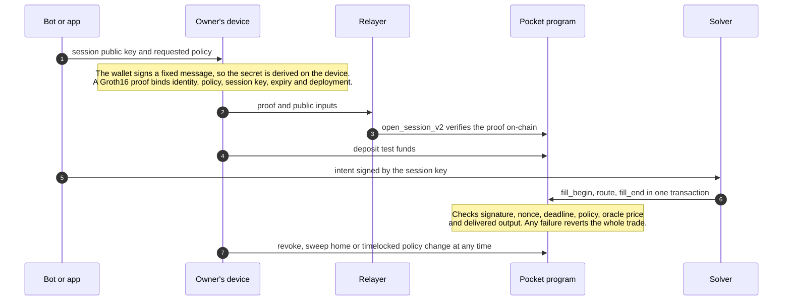

<h1 align="center">GhostLink</h1>

<p align="center"><strong>Prove what an app needs. Give it only the spending authority you approve.</strong></p>

<p align="center">Zero-knowledge login and policy-bounded spending accounts for Solana apps and trading bots.<br>No wallet address in the login proof. No private key handed to the bot.</p>

<p align="center">
  <a href="https://github.com/Ghostlink-Labs/ghostlink/actions/workflows/ci.yml"></a>
  <a href="LICENSE"></a>
  
  
  
</p>

<p align="center">
  <a href="#quickstart">Quickstart</a> ·
  <a href="#how-it-works">How it works</a> ·
  <a href="#packages">Packages</a> ·
  <a href="#documentation">Docs</a> ·
  <a href="https://app.ghostlink.software">Devnet app</a> ·
  <a href="https://ghostlink.software">Website</a> ·
  <a href="CONTRIBUTING.md">Contribute</a>
</p>

---

Trading bots ask for your private key. "Connect wallet" logins tie your on-chain history to every site you use. One leaked key or one careless approval can empty a wallet.

**GhostLink separates proving who you are from giving an app permission to spend.**

| | |
| --- | --- |
| **Private login** | Prove you are a registered user, or that you held at least N of a token, with a zero-knowledge proof. The proof does not contain your wallet address, and every site sees its own stable user ID that cannot be linked to your ID on any other site. |
| **Pockets** | Each app gets its own on-chain account with rules you approve: a daily USD cap, a slippage limit, allowed tokens and a maximum session length. Money leaves a pocket only through a trade that settles inside those rules, or back to your home wallet. |
| **Session keys** | A bot gets a temporary key that signs exact swap intents for one pocket. It cannot withdraw anywhere but your home wallet, raise its own limits or change where recovery goes. Revoke it at any time. |

Proofs are Groth16 over BN254, generated on the user's device and verified **on-chain** by the Solana programs, or by your server for off-chain login.

> [!WARNING]
> **Experimental. Test networks only.** The proving keys come from a single-party development setup, and the code has not had an external security audit. Do not use real funds. See [project status](#project-status).

## Quickstart

Verify a real zero-knowledge login proof in under a minute. You need Node 22 and pnpm (`corepack enable` installs the pinned version).

```bash
git clone https://github.com/Ghostlink-Labs/ghostlink.git
cd ghostlink
corepack enable
pnpm install --frozen-lockfile
pnpm -r build
pnpm --filter @ghostlink/example-verify-login start
```

```text
GhostLink login verification: a real Groth16 proof with no wallet address inside

ok    valid proof for this site                  accepted, app user ID 128256...5697
ok    replayed on another site                   rejected: proof bound to a different domain
ok    site demands 200 tokens, proof shows 100   rejected: threshold below requirement
ok    same proof a day later: snapshot too old   rejected: snapshot window too old
ok    built against an unknown tree              rejected: unknown registry root
ok    tampered public signal                     rejected: proof failed verification
```

Then try the [bot session example](examples/bot-session/src/index.ts) (`pnpm --filter @ghostlink/example-bot-session start`), or run **the whole system on a local validator** (Linux or WSL with the Solana toolchain, see [setup](docs/SETUP.md)):

```bash
bash scripts/build-programs.sh
bash scripts/localnet-e2e.sh   # register → snapshot → consent → prove → open → fund → trade → recover
```

## Use it

### Gate your site with a private login

The user's browser builds the proof with `@ghostlink/sdk`. The wallet signs a fixed message, the identity secret is derived on the device, and only the proof and its public inputs leave it. Your backend checks the proof with `@ghostlink/verify`:

```ts
import { verifyLogin, verifyLoginChallenge } from "@ghostlink/verify";

const nonce = await challenges.take(body.challengeId);    // single-use, short-lived, issued by you
const currentSlot = BigInt(await rpc.getSlot("confirmed")); // your own RPC, never the client

const result = await verifyLogin({
  proof: body.proof,                  // LoginProof.snarkjsProof from the SDK
  publicSignals: body.publicSignals,
  expectedDomain: "https://app.example.com",
  roots: trustedRoots,                // your indexer, or the on-chain root rings; never the client
  expect: {
    holdsAtLeast: { mintHi, mintLo, threshold: 100_000_000n },  // optional token gate...
    minSlot: currentSlot - 10_000n,                             // ...with a freshness bound
    session: { key32, expirySlot, currentSlot },                // bind the proof to one session key
  },
});

// A copied proof is not a login: the session key must also have signed your nonce.
if (nonce && result.ok && verifyLoginChallenge({ key32, nonce, signature })) {
  signIn(result.appId);  // stable for your site, unlinkable elsewhere
}
```

The [`@ghostlink/verify` guide](packages/verify/README.md) covers the full flow, including passkey sessions.

### Give a bot a budget, not your keys

```ts
import { sessionPublicKey, signIntent, softwareSession, SESSION_KIND_ED25519 } from "@ghostlink/sdk";

// Bot: create a session key and share only its public half.
const bot = softwareSession();
const request = sessionPublicKey(SESSION_KIND_ED25519, bot.key32);

// Owner, on their own trusted device: review the bot, policy, home and expiry, then approve.
const authorization = await client.authorizeSession({ identity, witness, home, expirySlot, policy, session: request });
const pocket = client.pocketFor(authorization, home, policy);
await client.openSession(authorization, pocket, { mint: new Uint8Array(32), threshold: 0n, minSlot: 0n, claim: false });

// Bot: sign exact intents. The Pocket program checks the signature, policy and delivered output.
const signed = await signIntent(pocket, bot, { nonce, inMint, inMax, outMint, outMin, deadlineSlot });
```

The bot never sees the owner's identity secret, proof inputs or wallet key. [`@ghostlink/bot`](packages/bot/README.md) adds Telegram authentication, encrypted key storage, durable nonces and order recovery. Read the [integration guide](docs/INTEGRATIONS.md) for what an integration must still do itself.

## How it works



| Layer | What it is |
| --- | --- |
| [Registry program](programs/registry/) | Appends each wallet's identity commitment to a depth-26 Poseidon Merkle tree, once. No admin, no updates. |
| [Census program](programs/census/) | Permissionless token-balance snapshots in a second tree, so holdings can be proved without naming the wallet. |
| [Pocket program](programs/pocket/) | Per-app accounts that verify login and owner proofs, enforce the policy and settle intents atomically. Withdrawals only ever go home. |
| [Verifier crate](programs/verifier/) | Groth16 verification over Solana's alt_bn128 syscalls, Poseidon, Merkle frontier and root ring. Linked into the programs. |
| [Circuits](circuits/) | `login` (membership, app-scoped ID, optional holdings claim, session and policy binding) and `owner` (ownership plus an exact action). |
| [Services](services/) | Reference indexer, relayer, solver, Solana Actions endpoint and watcher, with durable state and crash recovery. |

The TypeScript encoders, Rust programs and circom circuits share one set of [test vectors](packages/common/fixtures/vectors.json), so any byte-level drift between them fails CI.

## Packages

| Package | What it gives you |
| --- | --- |
| [`@ghostlink/sdk`](packages/sdk/) | Identity derivation, proofs, session keys, pockets, intents, funding checks and a durable relayer client |
| [`@ghostlink/verify`](packages/verify/) | Server-side login proof verification with domain, claim, freshness, session, root and challenge-signature checks |
| [`@ghostlink/prover-wasm`](packages/prover-wasm/) | In-browser Groth16 prover with pinned artifact hashes |
| [`@ghostlink/react`](packages/react/) | `GhostLinkProvider`, `useGhostLink` and an unstyled `ContinueWithGhostLink` button |
| [`@ghostlink/bot`](packages/bot/) | Node.js bot backend: Telegram authentication, owner consent, encrypted session keys and durable orders |
| [`@ghostlink/common`](packages/common/) | Canonical encodings, Poseidon hashes, Merkle trees, PDAs and the cross-language vectors |

The packages are not on npm yet. Build installable archives with checksums from source:

```bash
pnpm pack:sdk && pnpm test:package   # writes artifacts/sdk/*.tgz and SHA256SUMS
```

## Project status

| Piece | State |
| --- | --- |
| Programs, circuits, SDK and services (V2 protocol) | Built and tested. CI runs more than 440 automated tests: TypeScript, Rust, LiteSVM program flows, circuits, runnable examples and installed-package checks |
| Full journey on a local validator | Passing: register, snapshot, consent, prove, open, fund, trade and recover |
| [Hosted devnet app](https://app.ghostlink.software) | Live with test tokens, running the earlier V1 deployment. [Walkthrough](docs/WALKTHROUGH.md) |
| Mainnet | Not yet |

**On the way to mainnet:**

- [x] Policy-bound V2 authorization: each proof commits to the exact policy, session kind and deployment
- [x] Bot backend with Telegram authentication, encrypted keys and crash-safe order recovery
- [x] Experimental single-hop Jupiter/Raydium route, tested on a local fork
- [ ] npm releases with provenance
- [ ] Public phase-2 [trusted-setup ceremony](docs/CEREMONY.md) to replace the development keys
- [ ] External security audit of the circuits, programs and SDK
- [ ] Token-2022 support, more routes, copy-trading and DCA triggers
- [ ] Python, Rust and Go clients
- [ ] Capped mainnet pilot

The full checklist, with the evidence each gate needs, is in [mainnet readiness](docs/MAINNET-READINESS.md).

## Documentation

| Start here | |
| --- | --- |
| [Setup](docs/SETUP.md) | Toolchain, building, testing and the local stack |
| [Integration guide](docs/INTEGRATIONS.md) | What GhostLink guarantees, and what your integration must do |
| [Threat model](docs/THREAT-MODEL.md) | Trust boundaries, assumptions and known limits |
| [Owner consent](docs/OWNER-CONSENT.md) · [owner recovery](docs/OWNER-RECOVERY.md) | Approving bots, revoking them and getting funds back |
| [Transaction recovery](docs/TRANSACTION-RECOVERY.md) | Handling timeouts and uncertain submissions safely |
| [Design decisions](docs/adr/) | Why the protocol works the way it does |
| Operations | [Indexer](docs/INDEXER-OPERATIONS.md) · [relayer](docs/RELAYER-OPERATIONS.md) · [solver](docs/SOLVER-OPERATIONS.md) · [Actions](docs/ACTIONS-OPERATIONS.md) · [watcher](docs/WATCHER-OPERATIONS.md) · [RPC](docs/RPC-OPERATIONS.md) · [backup and restore](docs/BACKUP-RESTORE.md) |

## Contributing

GhostLink is early, and contributions shape it. Good places to start: the [examples](examples/), issues labelled [`good first issue`](https://github.com/Ghostlink-Labs/ghostlink/labels/good%20first%20issue), tests for authorization and recovery paths, and integrations such as language clients or DEX adapters. Read [CONTRIBUTING.md](CONTRIBUTING.md) to get set up, and follow the [code of conduct](CODE_OF_CONDUCT.md).

If GhostLink is useful to you, a star helps other developers find it.

## Security

Report vulnerabilities privately as described in [SECURITY.md](SECURITY.md), never in a public issue. Open source makes the code inspectable. It is not an audit.

## License

The protocol, circuits, SDKs, services and docs are [Apache-2.0](LICENSE). Some dependencies are not: snarkjs and circomlib are GPL-3.0. The GhostLink name and logo are covered by the [brand policy](BRAND_POLICY.md), the four documentation screenshots have [their own terms](docs/media/screenshots/LICENSE.md), and the hosted application's source is not part of this repository. [LICENSING.md](LICENSING.md) explains the boundaries.
